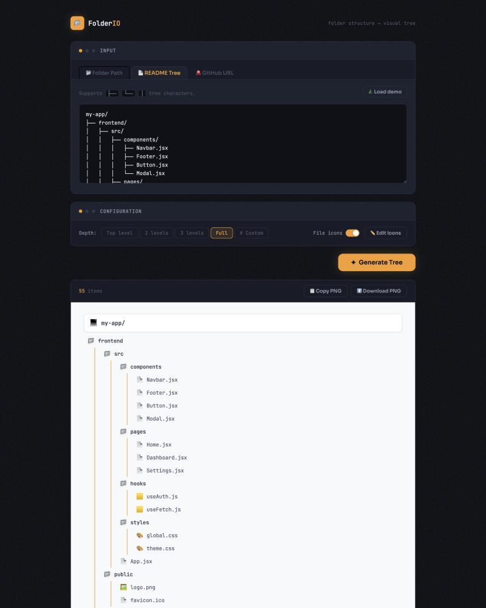

<div align="center">

# 📂 FolderIO

**Turn any folder structure into a clean visual tree, ready to drop into docs, slides or a README.**

[**Open the app →**](https://guynoimark.github.io/folder-snap/)



</div>

## What it does

Paste a structure in, pick how deep to go, and get a tidy tree image back.

**Three ways to put a tree in:**
- **📂 Folder Path:** paste one full path per line. The first line is the root. Works with Windows `\` and Unix `/` paths.
- **📄 README Tree:** paste a text tree that uses `├──`, `└──` and `│`, like the ones in most READMEs.
- **🐙 GitHub URL:** paste a repo link and it reads the repo's structure. An optional GitHub token unlocks private repos and higher rate limits.

**Then shape it:**
- Choose the depth: top level, 2 levels, 3 levels, full, or a custom number.
- Turn file-type icons on or off, and change the icon for any file extension.

**And take it with you:** copy the tree as a PNG to your clipboard, or download it.

Not sure where to start? Hit **🌲 Load demo**.

## Run it locally

It's a single `index.html` with no build step. Open it in a browser, or serve the folder:

```bash
npx serve .
```
